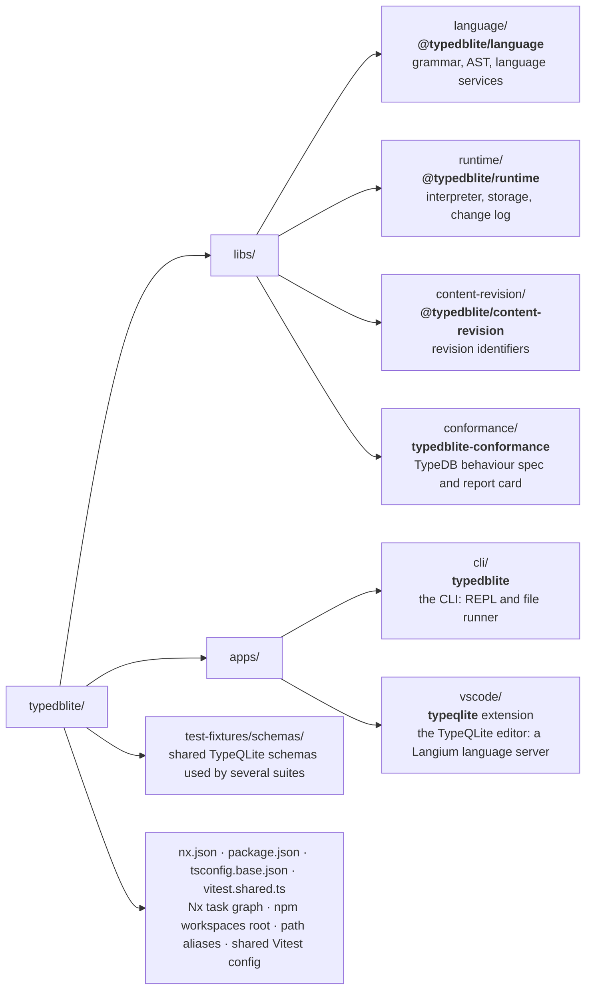
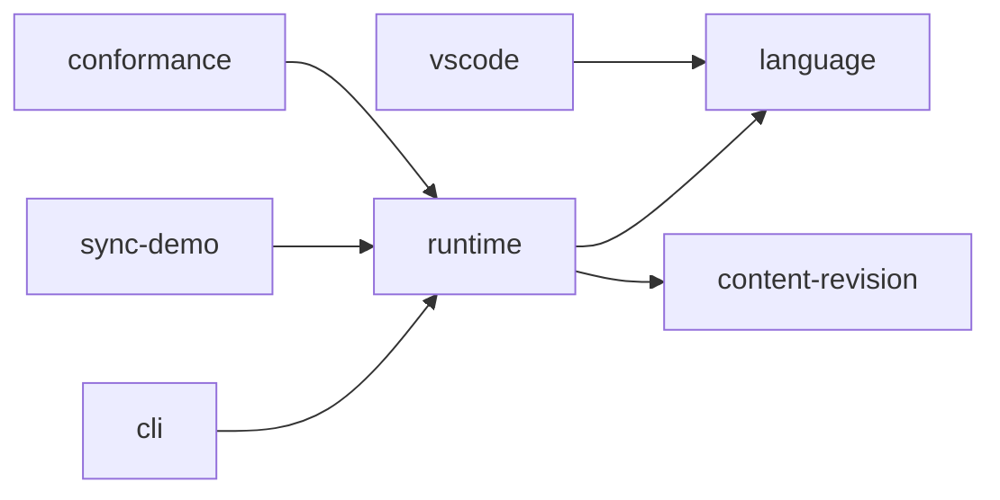

# AGENTS.md — Working in TypeDBLite

This file is for AI agents and automated tools working in this repository. It describes the layout, the invariants, and the conventions that must be respected when making changes. Human contributors: start with [CONTRIBUTING.md](CONTRIBUTING.md) and [docs/](docs/README.md), which say the same things at greater length.

---

## Repository layout



## Dependency graph



`apps/sync-demo` (the offline-first sync demo) depends on `@typedblite/runtime` only, through its public entry points — never `src/` (its feature doc's invariant 3).

Build order is enforced by Nx. `runtime` must build before `cli` and `conformance`. `language` and `content-revision` must build before `runtime`.

---

## Build and test commands

Always run from the workspace root.

```bash
# Build everything (respects dependency order)
npm run build

# Test everything
npm run test

# The whole gate, from a clean tree: build, typecheck, tests with the coverage floor, WASM, browser, e2e.
# GitHub Actions is off for now, so this is the only check. `-- --quick` skips the last three.
npm run gate

# Type-check everything
npm run typecheck

# Single project — replace <project> with the Nx project name
npm exec nx -- run <project>:build
npm exec nx -- run <project>:test
npm exec nx -- run <project>:typecheck
```

Nx project names (not the npm package names):
- `typeqlite-language` — `@typedblite/language`
- `typedblite-runtime` — `@typedblite/runtime` (no `typecheck` target; `build` type-checks). Also `bench`, the load test: timings on real schemas and data, never part of `test` ([docs/development/performance.md](docs/development/performance.md))
- `content-revision` — `@typedblite/content-revision`
- `typedblite-conformance` — also has `report`
- `typedblite` — the CLI, npm package `typedblite` (it was `typedblite-cli`; `npx typedblite` needs the unscoped name)
- `typeqlite-vscode` — the VS Code extension `typeqlite`; also has `package` and `e2e`
- `playground` — `typedblite-playground`, TypeQLite in a browser: the engine on WASM SQLite in a worker, and Monaco with the real language server over LSP in another; also has `test-browser` and `serve`
- `sync-demo` — `typedblite-sync-demo`, the offline-first sync demo; also has `smoke`, `test-browser`, `serve`, `demo` and `android-setup`/`android-apk`/`android-emulator`

Coverage is enabled only on CI (`CI=true`), with an 80% floor on statements, lines and functions in
every project. 🔴 Never exclude a file to pass the floor unless it only runs inside a host the unit
runner lacks (VS Code, a browser or worker, Electron, a live TypeDB, a separate process). Exclude it by
name in the project's `vitest.config.ts`, saying where it is run instead ([Testing](docs/development/testing.md)).
Test suites time out at 30 seconds per test.

### Packaging

Four packages are published to npm, at one version, by Nx release: `@typedblite/content-revision`,
`@typedblite/language`, `@typedblite/runtime` and the CLI, `typedblite`. They are listed in
`tools/publishable.mjs`, which must agree with `release.projects` in `nx.json`.
[Releasing](docs/development/releasing.md) is the process; [Versions and compatibility](docs/guides/compatibility.md)
is what a version promises.

```bash
npm run check-packages   # what `npm publish` would ship, read from `npm pack --dry-run` (after a build)
npm run clean-room       # the tarballs installed in an empty directory and used (needs the registry)
```

- 🔴 A published package has a `files` allowlist. Without one npm falls back to `.gitignore`, which excludes
  `out/`: the runtime once would have shipped its sources and tests and no JavaScript.
- A private workspace package (conformance, the demos, the playground, the extension) depends on a published one
  at `"*"`, never an exact version, so a release that bumps the published packages leaves it linked to the
  workspace copy.
- `@sqlite.org/sqlite-wasm` versions all carry a `-buildN` suffix, a semver prerelease, so a range such as
  `^3.54.0` matches none of them. The runtime's optional peer range names the tested SQLite version's builds.
- The registry for publishing is set on `nx-release-publish` in `nx.json`, not in a manifest.

---

## Language and grammar

The TypeQLite grammar is in [libs/language/src/typeqlite.langium](libs/language/src/typeqlite.langium). It is a [Langium](https://langium.org) grammar.

**To regenerate the AST after a grammar change:**

```bash
cd libs/language
npm run langium:generate
```

This regenerates `src/generated/ast.ts`, `src/generated/grammar.ts`, and `src/generated/module.ts`, and then the TextMate grammar, `syntaxes/typeqlite.tmLanguage.json` (`scripts/generate-textmate.mts`). `src/generated/` and `syntaxes/` are gitignored: the `build`, `test` and `typecheck` targets regenerate it first (`langium-generate`), so commit the grammar, not the output.

**Grammar scope discipline.** A construct is added to the grammar only when a real caller needs it. The rule is "find the caller first". The TypeDB behaviour spec (`libs/conformance/spec/`) is a first-class caller — if the spec's Background steps require a construct, add it.

**Every keyword needs a TextMate scope.** The TextMate grammar takes its keywords from the Langium grammar and their scopes from `KEYWORD_SCOPES` in `typeqlite-textmate.ts`: `keyword.control`, `storage.type` for kinds, `storage.modifier` for value types, and so on, the same scopes as TypeDB's TypeQL grammar, so a theme colours TypeQLite as it colours TypeQL. A new keyword fails `typeqlite-textmate.spec.ts` until it has one, and generation refuses a stale entry. Annotations are scoped by their `@`, with no entry.

**Annotation admissibility.** Which annotations are valid on which positions is tracked in the validator's admissibility table (`typeqlite-annotations.ts`). `@key` is enforced at write time by the runtime. All other annotations parse successfully, but their runtime semantics are tracked scenario-by-scenario on the conformance report card.

---

## Runtime

### SQLite binding contract

The interpreter works through a `SqliteDatabase` interface (`libs/runtime/src/sqlite-database.ts`), not against `node:sqlite` directly. Only `node-sqlite.ts` imports `node:sqlite`. When adding a new SQLite operation, add it to the interface and implement it in `node-sqlite.ts` **and** `wasm.ts`, then run `test-wasm` and `test-browser`.

**The runtime runs in browsers too** (ADR-009). `src/index.browser.ts` is the `browser` export condition: everything except `node-sqlite.ts` and `change-stream.ts` (the hub, `node:http`); `src/index.ts` re-exports it and adds those two. The interpreter's default opener is the conditional import `#default-opener` (package.json `imports`): `node:sqlite` under `node`, a refusal elsewhere. 🔴 Nothing reachable from `index.browser.ts` may import a `node:` module — `test/browser-entry.test.ts` bundles it for the browser and fails if it does. `content-revision` hashes with its own synchronous SHA-256 (`sha256.ts`), pinned to the `node:crypto` digest by `sha256.spec.ts`.

Key constraints:
- **Synchronous**. The interpreter runs ~250 SQLite calls inside transactions. No async binding satisfies the interface.
- **Named parameters without prefix.** `.all({ id })` binds `:id`. Adapters that require `{ ':id': id }` must translate.
- **`run()` must report `changes` exactly.** The change log uses `changes > 0` to decide whether a revision was new.
- **`exec` must handle multiple statements** in a single string (schema DDL uses this).

### Schema and data

The SQLite schema is generated from a TypeQLite `define` statement by `sqlite-generator.ts`. The interpreter in `interpreter.ts` translates TypeQLite queries to SQLite.

There is **no table per type**: the storage model mirrors TypeDB's. Every store has the same fixed tables — `thing` (one row per entity or relation), `attribute` (one row per type and value, ADR-006), `has` (ownership), `role_player`, `type_parent`, and `schema_*` tables. `@key`/`@unique` are a partial `UNIQUE` index on `has`; role players have foreign keys to `thing` (`PRAGMA foreign_keys = ON` on every connection). New storage is added additively (`CREATE TABLE IF NOT EXISTS`), never by changing an existing table's shape.

### Change log and replication

Every write appends to a change log. Revisions are `generation-digest` strings (`@typedblite/content-revision`). The revision is derived deterministically from content, so the same edit on two nodes produces the same revision and converges rather than conflicting.

The hub exposes Server-Sent Events for spokes to subscribe to. The `ChangeStream` interface (`change-stream.ts`) is the hub's side. `ChangeStreamClient` (`change-stream-client.ts`) is the spoke's side.

**Do not change the revision algorithm** in `content-revision/src/lib/revision.ts` casually. 🔴 The CouchDB parity oracle that once proved these semantics was removed (2026-09); `test-oracle` now only runs an FTS parity test against an external index. Nothing re-checks CouchDB parity, so a change here needs its own tests and an ADR-003 amendment. The hash itself is pinned to the pre-ADR-009 `node:crypto` digest by `sha256.spec.ts`.

---

## Conformance

`libs/conformance/` vendors the TypeDB behaviour specification as Cucumber `.feature` files under `spec/`. The test suite (`test/conformance.test.ts`) runs every scenario and compares against `baseline.json`.

### Deviations

Intentional failures are declared in `deviations.yaml`:
- Each entry needs an **owner**: an ADR number (`adr-NNN`) or a defect record id.
- An entry whose scenario starts passing is reported by the run as `deviationsNowPassing`. Remove it in the same commit that fixes the behaviour.
- Do not declare a deviation against a scenario that fails for a different reason (e.g. a Background step fails before the deviation is reached).

### Baseline

`baseline.json` records the last-known pass/fail count per feature file. The test fails if a scenario regresses below the baseline. Update the baseline when scenarios improve:

```bash
npm exec nx -- run typedblite-conformance:test     # fails on a regression AND on an unraised improvement
npm exec nx -- run typedblite-conformance:report   # the full card and a failure digest
# Raise the numbers in baseline.json by hand, in the same commit as the improvement
```

---

## Testing conventions

- Test files for `libs/language` live in `libs/language/test/` with `.spec.ts` extension.
- Test files for `libs/runtime` live in `libs/runtime/test/` with `.test.ts` extension.
- Test files for `apps/cli` live in `apps/cli/test/` with `.test.mts` extension.
- Test files for `apps/vscode` live in `apps/vscode/test/` (`.test.ts`, run by vitest against the built
  bundle; the Markdown preview's modules that import no `vscode` are tested from source). Its e2e (`nx run typeqlite-vscode:e2e`) packages the extension, installs the `.vsix` into a
  downloaded VS Code through `@vscode/test-electron`, and runs the cases there. It is off by default:
  run it when changing anything an editor sees. It needs a display (`xvfb-run` when headless).
- Language-service specs that involve more than one file use `libs/language/test/workspace.ts`, which
  builds several documents into one workspace with its own services and an in-memory file system.

## The editor

`apps/vscode` is a client plus a language server that runs `createTypeQLiteServices` unchanged
([ADR-008](docs/architecture/adr-008-the-typeqlite-editor-is-a-langium-language-server-in-this-repository.md)).
🔴 **Nothing the editor knows may reach the runtime.** The interpreter runs every check registered in
`ValidationRegistry` (through `validateSync`), so a check registered there is a runtime rule. An
editor-only diagnostic belongs in a `DocumentValidator` subclass, which the runtime never runs. The
file extensions it claims come from `langium-config.json`, and a test fails if the manifest differs.

Labels in queries (`isa person`, `has name`, role players) are plain `ID`s, not cross-references, and
must stay so (ADR-008 D5). The editor resolves them through `TypeQLiteLabels`, whose position table
(`sitesOf`, and `LABEL_POSITIONS` for completion) must change whenever the grammar gains a position
that names a type. `nx run typeqlite-vscode:package` builds `apps/vscode/dist/typeqlite-0.0.1.vsix`.

The extension also colours TypeQLite code blocks in VS Code's Markdown preview
([ADR-010](docs/architecture/adr-010-the-markdown-preview-highlights-typeqlite-in-the-editor-s-colours.md)).
The server classifies, through the `typeqlite/highlightBlocks` request: TextMate scopes from the
grammar file the extension ships, and the editor's own semantic tokens. The client only maps those to
the active theme's colours, which it reads from the theme's files (`src/markdown/theme.ts` restates
VS Code's rules for that). In a remote window the theme is not in the extension's host, so a second
extension, the TypeQLite Theme Bridge (`theme-bridge/`, `src/theme-bridge.ts`, `extensionKind: ["ui"]`),
reads the files where VS Code keeps them and answers `typeqlite.themeFiles`. `package` builds both
`.vsix` files, and `e2e` installs both. In the Markdown *editor*, `grammars/typeqlite-markdown-injection.json` injects the same TextMate grammar into fences of the same languages, and a manifest test keeps the two lists equal. 🔴 Keep TypeQLite knowledge out of `src/markdown/`: a keyword list or
token rule there would be a second definition of the language.
- Shared TypeQLite schema fixtures used by multiple suites live in `test-fixtures/schemas/`.
- `typedblite-runtime:test-wasm` runs the whole runtime suite on WASM SQLite, and `typedblite-runtime:test-browser` runs the engine in a real Chromium on OPFS (ADR-009). Run both after touching the binding interface, `src/wasm.ts` or `content-revision`. `test-oracle` needs an external search index and is not routine ([Testing](docs/development/testing.md#the-engine-on-wasm-sqlite)).

---

## Code style and conventions

- **TypeScript strict mode** throughout. No `any` without a reason documented inline.
- **ESM everywhere.** All packages use `"type": "module"`. Import paths in source use `.js` extensions (resolved to `.ts` by TypeScript's `bundler`/`NodeNext` strategy).
- **No default exports.** Named exports only.
- **No barrel re-exports of internal implementation.** Each package's `index.ts` exports only the public API.
- **Diagnostic codes** (`DiagnosticCode`) are the right way to report a schema or query problem from the runtime. Do not throw a plain `Error` for a user-visible condition that should produce a structured diagnostic.
- **Comments explain WHY, not WHAT.** A comment that restates what the code obviously does adds noise. A `🔴` marker in a comment means the note is non-obvious, was found through debugging or a spec reading, and would be easy to get wrong again.

---

## Adding a new TypeQLite construct

1. Add the production rule to `libs/language/src/typeqlite.langium`.
2. Run `npm run langium:generate` inside `libs/language/`.
3. Give each new keyword a scope in `KEYWORD_SCOPES` (`typeqlite-textmate.ts`). The generator refuses until you do.
4. Update the admissibility table in `typeqlite-annotations.ts` if the construct accepts annotations.
5. Add validation in `typeqlite-validator.ts` if the construct has parse-time constraints.
6. Add SQLite generation in `libs/runtime/src/sqlite-generator.ts`.
7. Add interpreter handling in `libs/runtime/src/interpreter.ts`.
8. Add tests in `libs/runtime/test/` covering the new behaviour.
9. Run the full conformance suite to check for regressions: `nx run typedblite-conformance:test`.

---

## Common mistakes to avoid

| Mistake | Why it matters |
|---|---|
| Importing `node:sqlite` outside `node-sqlite.ts` | Breaks the browser/WASM portability boundary |
| Using `async` in the interpreter's inner loop | The `SqliteDatabase` interface is synchronous by design |
| Hardcoding `:memory:` in a test | Use the fixture helpers; they create an isolated session per test |
| Declaring a deviation before the scenario's Background passes | The deviation isn't the real reason for failure yet |
| Changing revision semantics without new tests | CouchDB parity is no longer checked by any suite; stores written by different versions must still converge |
| Editing the grammar without regenerating locally | Tools run from source (`tsx`, vitest aliases) read `src/generated/`, which only `langium-generate` refreshes |
| Adding a construct to the grammar with no caller | Grammar scope is measured, not guessed — find the caller first |
| Squash-merging or rebase-merging a pull request | Merge pull requests with a merge commit only. Squashing collapses its commits into one, and rebasing rewrites their hashes: either loses the individual history, which the maintainer wants kept |
| Trusting a gate after a dependency bump without a clean build | `build` is `tsc -b`, which is incremental: a library whose sources did not change is not re-emitted, so its dependants are judged against stale declarations, even with `--skip-nx-cache`. Delete `out/` and `*.tsbuildinfo` first (the `vscode-languageserver` 10 bump hid a type error for a whole phase this way) |

---

## Working with Nx

<!-- nx configuration start-->
<!-- Leave the start & end comments to automatically receive updates. -->

- For navigating/exploring the workspace, invoke the `nx-workspace` skill first — it has patterns for querying projects, targets, and dependencies
- When running tasks (build, lint, test, e2e, etc.), always prefer running through `nx` (`nx run`, `nx run-many`, `nx affected`) instead of the underlying tooling directly
- Prefix nx commands with the workspace's package manager (`npm exec nx build`) — avoids using a globally installed CLI
- You have access to the Nx MCP server and its tools; use them to help the user
- For Nx plugin best practices, check `node_modules/@nx/<plugin>/PLUGIN.md` — not all plugins have this file, proceed without it if unavailable
- **Never guess CLI flags** — always check `nx_docs` or `--help` first when unsure

### Scaffolding and generators

For scaffolding tasks (creating apps, libs, project structure, setup), always invoke the `nx-generate` skill **first** before exploring or calling MCP tools.

### When to use nx_docs

- **Use for:** advanced config options, unfamiliar flags, migration guides, plugin configuration, edge cases
- **Don't use for:** basic generator syntax (`nx g @nx/react:app`), standard commands, things you already know
- The `nx-generate` skill handles generator discovery internally — don't call nx_docs just to look up generator syntax

<!-- nx configuration end-->
