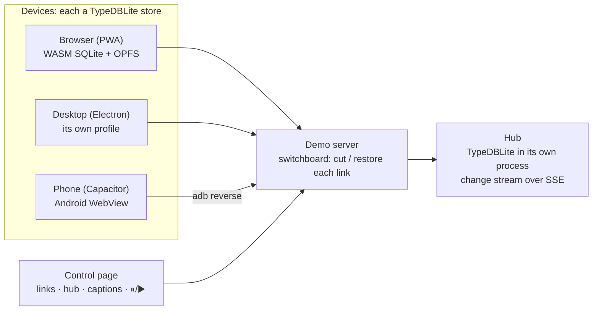

# TypeDBLite sync demo

Offline-first sync, shown end to end. Three devices each hold their own TypeDBLite store: a browser,
a desktop app and an Android phone. They replicate through a hub that is also TypeDBLite. You can cut
any device's network, or stop the hub, and watch every device keep working and then converge again.

Nothing leaves your machine. There is no server to sign up for, no Docker and no cloud service.



## What is real

Everything a device does is TypeDBLite's public API: `@typedblite/runtime`, and in the browser
`@typedblite/runtime/wasm`
([ADR-009](../../docs/architecture/adr-009-typedblite-runs-in-the-browser-on-wasm-sqlite.md)).

- **Every write lands in the device's own store first.** The engine records it in its change log in
  the same transaction.
- **Every 1.5 s, and at once after a write,** each device runs
  `TypeDBLiteReplicator.replicateOnce({ direction: 'duplex', from: cursor, timeoutMs })` against the
  hub.
- **Offline, the change log is the journal.** The next successful sync sends everything after the
  push cursor, and pulls what the device missed.
- **A failed sync is shown as offline, never as "in sync".** That includes a hub that answers 502
  or never answers.
- **The hub is a TypeDBLite store in its own process,** serving `createChangeStreamHandler`. Stopping
  it is a real outage, and its store survives a restart.

What is built for the demo: the task page, the service worker, the Electron and Capacitor shells, the
switchboard, and the Playwright driver. The task schema is one keyed type:

```typeql
entity task, owns task-id @key, owns title, owns done, owns created-at, owns origin;
```

`@key` is what makes a task replicable. Its identity on every device is `task/<task-id>`.

## Setup

From the repository root, on a machine with Node.js 22.16 or later:

```bash
npm install                              # also downloads Electron 42
npx playwright-core install chromium     # the browser the driver and the tests use
npm exec nx -- run sync-demo:build       # the server, the hub and the client
```

**For the phone (optional):**

```bash
npm exec nx -- run sync-demo:android-setup   # JDK 21, the Android SDK, an emulator image, the AVD, the app
sudo chmod 666 /dev/kvm                      # the emulator needs KVM (until the next reboot or WSL restart)
```

Under WSL the emulator also needs `libpulse`. `mobile/start-emulator.sh` explains how to install it
without root.

## Run it

**The scripted story.** This opens every window and waits for you to press ▶ Play on the control
page:

```bash
npm exec nx -- run sync-demo:android-emulator   # optional: boot the phone and install the app first
npm exec nx -- run sync-demo:demo -- --fresh
```

| Flag | Effect |
| ---- | ------ |
| `--fresh` | Wipe the hub's store and every device's store first |
| `--auto` | Run the story timed, without pressing Enter between steps |
| `--open` | Only open the windows, so you can drive them by hand |
| `--start-playing` | Start at once, instead of waiting for ▶ Play |
| `--no-android` | Leave the phone out. It is skipped anyway when `adb devices` lists no device |
| `--record` | Record each window as a silent WebM, and the captions as `captions.srt`, into `recordings/` |
| `--headless` | No windows: the whole story as a test run |

**Pausing for questions:** the ⏸ Pause button on the control page, or Space with that window
focused, holds the story before its next step or action. The devices keep working and syncing
while it is paused, so you can show things by hand. ▶ Play continues from where it stopped.

**By hand:**

```bash
npm exec nx -- run sync-demo:serve
```

Then open:
- `http://localhost:4300/?device=pwa` for the browser device;
- `http://localhost:4300/control` for the control page.

`npx electron apps/sync-demo/.build/electron-main.cjs` opens the desktop device.

The control page cuts and restores each link, and stops and starts the hub. The same switches are
available from a script:

```bash
curl -X POST localhost:4300/api/link/electron/down   # or /up; devices: pwa, electron, android
curl -X POST localhost:4300/api/hub/stop             # or /start
```

## The story

| # | Step | What it shows |
| - | ---- | ------------- |
| 1 | Three devices, one hub | Every store starts empty. Each device adds a task, and all three converge |
| 2 | Write anywhere | A task added in the browser reaches the others in a second or two |
| 3 | Edit elsewhere | The desktop completes the browser's task |
| 4 | The desktop loses its connection | Its link is cut. It adds two tasks and reopens one, and shows **"3 changes waiting to sync"**. Meanwhile another device writes, and the desktop does not see it |
| 5 | Reconnect | The journal replays, and everyone converges |
| 6 | The hub goes down | The hub process is stopped. Every device shows **"Offline — working locally"**, and keeps writing |
| 7 | The hub comes back | It restarts with its store intact. Everyone replays and converges |
| 8 | Truly offline | The browser goes fully offline and reloads. The service worker serves the app, OPFS serves the data, and it adds a task |
| 9 | Back online | Everything converges |

A step passes only when every device and the hub hold the same tasks, **and** those tasks are what
the step expects. Each convergence prints how long it took, typically 1 to 2 seconds.

## Tests

| Target | What it runs |
| ------ | ------------ |
| `nx run sync-demo:smoke` | The story's network events with three headless devices on `node:sqlite`, a real hub process, and the real switchboard. About 8 seconds |
| `nx run sync-demo:test-browser` | The PWA in two Chromium profiles, including a reload with no network; the Electron app; and the whole story, run headless by the driver |

## Troubleshooting

| Symptom | Fix |
| ------- | --- |
| A device says "Connecting…" forever | Is the server running on port 4300? For the phone: `adb reverse tcp:4300 tcp:4300` |
| Electron does not start ("Process failed to launch") | Unset `ELECTRON_RUN_AS_NODE`, which a VS Code terminal sets. The driver already does |
| "The emulator needs KVM" | `sudo chmod 666 /dev/kvm`, or add yourself to the `kvm` group |
| The emulator will not start: `libpulse.so.0` | See the comment at the top of `mobile/start-emulator.sh` |
| A device runs old code after a rebuild | Reload it once. The service worker is network-first |
| You want a clean slate | `--fresh`, or delete `apps/sync-demo/.data` |

## Layout

| Path | What it is |
| ---- | ---------- |
| `src/shared/` | `DemoDevice`, the device every client uses (platform-neutral), and the schema |
| `src/hub/` | The hub process |
| `src/server/` | The demo server: the switchboard, the hub's lifecycle, the control API |
| `src/client/` | The page, the device worker, the service worker, and the `Object.groupBy` polyfill for Android 14's WebView |
| `src/electron/` | The desktop shell |
| `src/driver/` | The story |
| `mobile/` | The Capacitor app, and the Android setup, build and emulator scripts |
| `static/control.html` | The control page |

The plan, the decisions and the evidence for every phase are in
[the feature document](../../docs/planning/sync-demo/sync-demo.feature.md).
