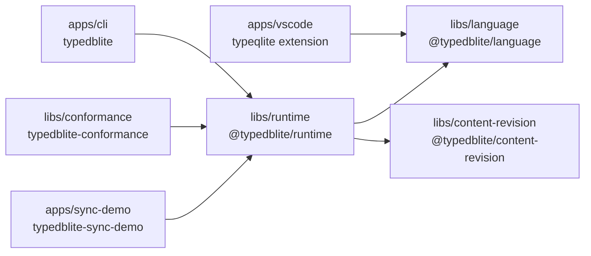
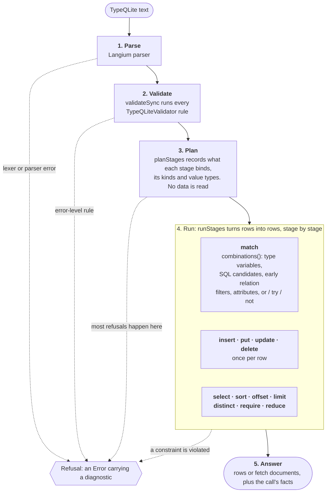

# Architecture

This page is a map of TypeDBLite for people changing it: what each package is for, how a statement
runs, how data is stored, and the design rules that keep it correct. The *why* behind each rule is in
the [architecture decision records](../architecture/), which the source code cites by number.

- [Packages and the dependency rule](#packages-and-the-dependency-rule)
- [How a statement runs](#how-a-statement-runs)
- [The storage model](#the-storage-model)
- [Failing loudly: three layers](#failing-loudly-three-layers)
- [Diagnostics](#diagnostics)
- [The language library serves two masters](#the-language-library-serves-two-masters)
- [The change log](#the-change-log)
- [Conformance is the oracle](#conformance-is-the-oracle)
- [Where things live](#where-things-live)

## Packages and the dependency rule

| Package | Nx project | Role |
| ------- | ---------- | ---- |
| `@typedblite/language` | `typeqlite-language` | The grammar, the generated AST and parser, the validator, and the language services an editor uses. **Touches no database** |
| `@typedblite/content-revision` | `content-revision` | Deterministic revision identifiers. No dependencies |
| `@typedblite/runtime` | `typedblite-runtime` | The engine: interpreter, storage, change log, replication, full-text search. **The only package that touches SQLite** |
| `typedblite-conformance` | `typedblite-conformance` | Runs TypeDB's behaviour specification against the runtime |
| `typedblite` | `typedblite` | The `typedblite` CLI: REPL, file runner and one-shot executor |
| `typeqlite` | `typeqlite-vscode` | The VS Code extension: a Langium language server over the language library |
| `typedblite-sync-demo` | `sync-demo` | The offline-first sync demo: browser, desktop and Android devices and a TypeDBLite hub. Uses only the runtime's public API |

The split follows [ADR-002](../architecture/adr-002-typeql-engine-as-a-port.md), Decision 4. A
parser belongs in every layer that needs to parse, so the language library must not drag a database
along with it.

## How a statement runs

Everything enters through three methods on `TypeDBLiteInterpreter`
([`interpreter.ts`](../../libs/runtime/src/interpreter.ts)).

### `query(text)` and `execute(text)`

1. **Parse.** A lexer or parser error throws `typedblite.parse-failed`.
2. **Validate.** An error-level rule throws. Anything milder is kept, and reported as a fact at the
   end of the call.
3. **Plan.** `planStages` walks the pipeline without touching data, and records which variables
   each stage makes available, with their kinds and value types. Most refusals happen here, before a
   single row is read.
4. **Run.** `runStages` passes an array of rows from stage to stage. In a `match`,
   `combinations()` solves type variables, finds candidates with SQL, filters a relation as soon as
   its players are bound (join planning), binds attributes, and then applies `or`, `try` and `not`.
5. **Answer.** Rows of `TypeDBLiteValue`, or `fetch` documents, with the call's facts.

- `execute()` runs each write pipeline in its own SQLite transaction, or in a savepoint when the
  caller has a transaction open. The change log is written inside it.
- A write stage is checked in full before **any** stage runs. A write that would fail on its first
  row is refused even when the `match` before it is empty.
- The engine is **synchronous**. `node:sqlite` is, and one query can make hundreds of SQLite calls.
  Do not introduce `async` into the interpreter.

### `define(text)`

`define`, `redefine` and `undefine` are checked against the schema already applied **and the data
already stored**, by [`schema-rules.ts`](../../libs/runtime/src/schema-rules.ts) and
[`schema-mutation.ts`](../../libs/runtime/src/schema-mutation.ts). Then
[`sqlite-generator.ts`](../../libs/runtime/src/sqlite-generator.ts) records the schema, and the
whole call commits as one transaction. Re-applying a definition that is already present is a no-op,
so `define` is safe to repeat.

## The storage model

TypeDBLite stores TypeDB's model, not a relational projection of it. **There is no table per type.**
Every store has the same fixed tables, whatever its schema:

| Table | Holds |
| ----- | ----- |
| `thing` | One row per entity or relation: `iid`, `type` |
| `attribute` | One row per attribute **type and value**, shared by all its owners ([ADR-006](../architecture/adr-006-an-attribute-is-stored-once-per-type-and-value.md)) |
| `has` | Ownership: `owner` → `attribute`. A `scope` column carries `@key` and `@unique`, enforced by a partial `UNIQUE` index |
| `role_player` | `rel`, `role`, `player`, with a count for a role played more than once |
| `type_parent` | The `sub` hierarchy, so `isa person` also matches subtypes |
| `schema_*` | The schema: elements, `owns`, `relates`, `plays`, value types, annotations, functions, structs, specialised roles, ordered ownerships |
| `change_log`, `key_attribute`, `pending_role` | Replication ([ADR-003](../architecture/adr-003-typedblite-change-log-and-sync-as-a-port.md)) |
| `entity_fts`, `entity_fts_key` | The FTS5 full-text index, and each entity's row in it, so a write finds that row without scanning the index ([Performance](performance.md#2-every-write-scanned-the-full-text-index)) |

Two guarantees come from SQLite's own constraint machinery rather than from application code:
- **A duplicate `@key` is unrepresentable.** The partial unique index refuses it.
- **A dangling role player is unrepresentable.** `role_player` has foreign keys to `thing`, and
  `PRAGMA foreign_keys = ON` is set on every connection. SQLite defaults it off.

[ADR-002](../architecture/adr-002-typeql-engine-as-a-port.md), Decision 3, makes these two the
contract any storage engine must meet.

The schema changes **additively**. A new table or column is created with `IF NOT EXISTS`, and a
store written by an older version gains it when it is next opened. SQLite cannot alter a `CHECK`
constraint in place, so new kinds of fact get new tables rather than new values in old columns.

## Failing loudly: three layers

[ADR-002](../architecture/adr-002-typeql-engine-as-a-port.md), Decision 7, is the rule the whole
engine is built around: **unsupported TypeQL fails, and never silently succeeds.**

1. **Unknown syntax** fails to parse.
2. **Syntax the engine has chosen not to implement** is refused by name, by the validator or by the
   planner (`typedblite.not-implemented`).
3. **Anything that reaches the interpreter unhandled** throws. This backstop must never become a
   no-op.

The failure mode this guards against is real: an embedded graph store that answered an edge to a
non-existent node by silently writing one between two unrelated nodes. When you add a code path,
ask what happens to the input it does not handle.

## Diagnostics

[ADR-004](../architecture/adr-004-typedblite-execution-diagnostics-as-a-returned-report.md):
diagnostics are **returned, never emitted**. The engine has no event bus and no logger. Each call
builds a fresh `DiagnosticCollector`:

- **Facts** (Information) describe what happened: `wrote`, `empty-match`, `no-candidates`. They are
  returned on the report.
- **Refusals** (Error) stop the call. They are thrown, with the diagnostic attached to the error
  (`attachDiagnostic` / `diagnosticOf`).

There is deliberately no Warning tier. Something either stopped execution or it did not.

Every code is a stable string in `DiagnosticCode`. A rule the validator owns keeps the validator's
code (`TypeQLiteValidationCode`), forwarded rather than re-declared, so there is one vocabulary.
Ranges point into the caller's text. Reports are capped at `MAX_DIAGNOSTICS` (50).

## The language library serves two masters

`@typedblite/language` is used by the runtime and by the editor, in very different ways:

| | Runtime | Editor |
| - | ------- | ------ |
| Parser | Yes | Yes |
| `ValidationRegistry` checks | Yes, through `validateSync` | Yes |
| Linking, scope, the index | **No.** It never builds a `LangiumDocument` | Yes, across the whole workspace |
| `DocumentValidator`, LSP providers | **No** | Yes |

🔴 **A check registered in `ValidationRegistry` is a runtime rule.** An `error` there refuses that
construct in the engine too. Editor-only diagnostics, such as the unknown-label warning, live in a
`DocumentValidator` subclass, which the runtime never runs
([ADR-008](../architecture/adr-008-the-typeqlite-editor-is-a-langium-language-server-in-this-repository.md),
D2).

Labels in queries (`isa person`, `has name`) are plain `ID`s in the grammar, not cross-references.
The editor resolves them itself, through `TypeQLiteLabels`, so the runtime's parse path stays free
of linking.

## The change log

[ADR-003](../architecture/adr-003-typedblite-change-log-and-sync-as-a-port.md). The interpreter
writes the change log **inside the same transaction as the data**, never afterwards. A commit
followed by a lost publish would be a change that never replicates and that nothing detects.

- Identity is `type/key-value`, never `thing.iid`. Keyless things are `local:` and do not replicate.
- Revisions are `generation-digest`, computed from content by `@typedblite/content-revision`, so
  identical edits converge.
- The semantics match CouchDB's revision trees, as proven against CouchDB 3.4.3 when they were
  built. 🔴 The suite that proved it has since been removed, so **nothing now re-checks that
  parity**. A change to the change log or the revision algorithm needs its own tests, and an
  amendment to ADR-003 if the semantics move
  ([Testing](testing.md#the-full-text-parity-oracle)).

## Conformance is the oracle

[ADR-005](../architecture/adr-005-typedb-s-behaviour-specification-is-typedblite-s-conformance-oracle.md):
TypeDB's own behaviour specification, vendored in `libs/conformance/spec/`, is the definition of
correct. The number of passing scenarios may never go down. A scenario TypeDB itself fails is a
declared deviation, not a TypeDBLite bug
([ADR-007](../architecture/adr-007-a-scenario-typedb-itself-fails-is-a-deviation.md)). See
[Testing](testing.md#the-conformance-report-card).

## Where things live

### `libs/runtime/src`

| File | Responsibility |
| ---- | -------------- |
| `interpreter.ts` | `TypeDBLiteInterpreter`: parse, plan, run, transactions, `TypeDBLiteValue` |
| `sqlite-engine.ts` | `SqliteEngine`, the async adapter |
| `sqlite-generator.ts` | The fixed storage tables, and recording a schema |
| `attribute-store.ts` | Attribute instances, ownership, and the sweep of ownerless attributes |
| `schema-rules.ts` | What `define` must check against the applied schema and data |
| `schema-mutation.ts` | `redefine` and `undefine` |
| `schema-subjects.ts` | The keys annotations are stored under |
| `schema-functions.ts` | `get_doc`, `get_meta`, `label` and other schema reads |
| `type-definitions.ts` | Which definitions declare or re-open a type |
| `type-patterns.ts` | Solving type variables in `match` |
| `expressions.ts` | Value expressions, built-in functions, comparisons |
| `temporal.ts` | Dates, datetimes, durations and their arithmetic |
| `reduce.ts` | The `reduce` stage and reducers |
| `fetch.ts` | `fetch` documents |
| `iid.ts` | The `0x…` iid form |
| `diagnostics.ts` | `DiagnosticCode`, the collector, attaching diagnostics to errors |
| `change-log.ts` | The change log, revision trees, projection of remote changes |
| `canonical.ts`, `revision.ts` | Replication identity and revisions |
| `replicator.ts` | `replicateOnce` between two endpoints |
| `change-stream.ts`, `change-stream-client.ts` | The SSE hub and its client |
| `typedblite-replicator.ts` | `TypeDBLiteReplicator`: one-shot and continuous replication over HTTP |
| `full-text.ts` | The FTS5 index |
| `sqlite-database.ts`, `node-sqlite.ts` | The binding interface, and its `node:sqlite` implementation |

### `libs/language/src`

| File | Responsibility |
| ---- | -------------- |
| `typeqlite.langium`, `terminals.langium` | **The grammar.** `generated/` is produced from it at build time |
| `typeqlite-module.ts` | The Langium dependency-injection module: every service wired up |
| `typeqlite-validator.ts` | Rules the grammar cannot express. **Shared with the runtime** |
| `typeqlite-annotations.ts` | Which annotation may sit where |
| `typeqlite-validation-codes.ts` | Stable codes for validator rules |
| `typeqlite-validate-sync.ts` | `validateSync`: the validator, without `async` |
| `typeqlite-scope.ts`, `typeqlite-scope-computation.ts` | Cross-references, and the workspace-wide schema |
| `typeqlite-labels.ts`, `typeqlite-label-providers.ts` | Resolving query labels, editor-side |
| `typeqlite-navigation.ts` | Outline, hover, symbol kinds |
| `typeqlite-completion.ts` | Completion |
| `typeqlite-edits.ts` | Rename and quick fixes |
| `typeqlite-formatter.ts`, `typeqlite-semantic-tokens.ts` | Formatting and highlighting |
| `typeqlite-doc-comments.ts` | `#!` doc comments, shared with the runtime |

### `libs/conformance/src`

`spec.ts` loads the vendored features. `steps.ts` and `world.ts` implement their Cucumber steps
against the runtime. `runner.ts` and `conformance.ts` run them. `report.ts` and `cli.ts` print the
report card. `oracle.ts` and `typedb-oracle.ts` run the same steps against a live TypeDB, and `oracle-bench.ts` times the load test's workloads on both (see the conformance README).
