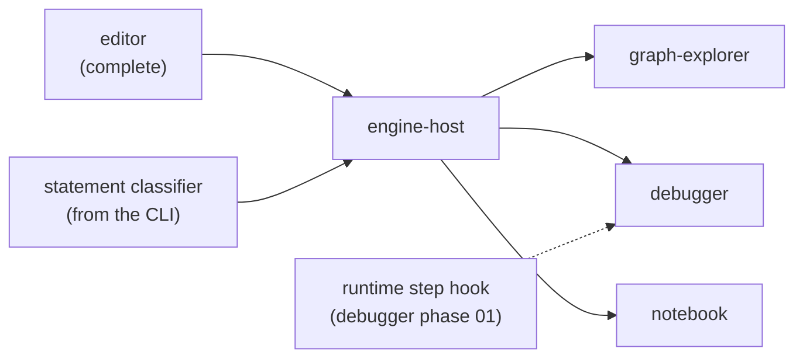

# TypeQLite Workbench — Initiative

> **Status:** 🚧 Started 2026-11-19; the engine host is built, the three consumers are next · **Written:** 2026-11-17 · **Branch:** none. An
> initiative has no branch; each feature is cut from `main`
> ([lifecycle standard](../../standards/governance/multi-phase-lifecycle-standard.md#branches)).
>
> The [editor](../editor/editor.feature.md) showed what a schema *says*. The workbench is the set of
> features that **run TypeQLite from the editor**: browse what a store holds, step through a query,
> and keep queries and their answers in a notebook. The editor's feature document said an initiative
> would earn its place once such a surface was planned
> ([Out of scope](../editor/editor.feature.md#out-of-scope)). Three were planned, and they need the
> same thing.

This document holds what a feature document cannot: **the dependency graph between the features, and
the sequencing that follows.** It does not repeat their goals, and it has no phases.

## The features

| Feature | Deliverable | Document |
| ------- | ----------- | -------- |
| **Engine host** | A standalone NestJS CQRS app, with the four standard transports and an MCP server, that runs statements in **sessions** | [engine-host](engine-host/engine-host.feature.md) |
| **Graph explorer** | Run a statement and see Log, Table, Graph and Raw; a schema graph; expand nodes | [graph-explorer](graph-explorer/graph-explorer.feature.md) |
| **Debugger** | A debug adapter, and the runtime hook that feeds it | [debugger](debugger/debugger.feature.md) |
| **Notebook** | A notebook file type, a controller that runs cells, an output renderer | [notebook](notebook/notebook.feature.md) |

## The dependency graph

The consumers reach the host over a transport (the editor over its sidecar, a webview over HTTP, an
agent over MCP). None of them imports it.

The three consumers do not depend on each other. Each depends on the engine host, and on the editor
through it. The dotted edge is work inside the debugger, not a feature.

## What the host owns, and what it does not

The host owns what two or more consumers need:

- **Where the engine runs:** in the host, a separate process. How the editor launches it is the
  host's Phase 00 question
  ([open question 1](engine-host/engine-host.feature.md#open-questions-for-phase-00)).
- **The session.** One store, opened once and kept across statements, with auto and manual
  transactions, a restart, and a close. The CLI already has the seed of this in
  [`TypeDBLiteSession`](../../../apps/cli/src/session.ts).
- **The statement classifier** (define, read or write), moved out of the CLI.
- **The operations**, declared once and reachable over **five transports**: CLI, REPL, sidecar,
  HTTP, and MCP. The host's operation set is the protocol the consumers share.

It does **not** own what only one consumer needs, so that it stays small:

| Stays with | What |
| ---------- | ---- |
| Graph explorer | The rule for writes to a real store; graph model; the webview |
| Debugger | Always running in `:memory:`; the step hook; the debug adapter |
| Notebook | The file format; cells mapped to a session; cross-cell language services |

## Sequencing

1. **Engine host first, alone.** It is the only feature all the others wait for. It is proven
   without VS Code, as a protocol driven from plain Node, so nothing else has to exist for it to
   be finished.
2. **Then the consumers, in any order.** The recommendation is the **notebook** or the **graph
   explorer** first, since both are mostly the host plus a surface. The **debugger** has the most
   unknowns (the step hook, the execution model) and does not block the other two. Its Phase 01
   can start in parallel with the host, because the hook lives in the runtime and does not need
   the host.
3. **Phase 00 of each consumer** re-reads the host's protocol as built, not as planned. A consumer
   that needs something the host lacks adds it to the host through a small change there, not a
   private path.

🔴 **A consumer never reaches around the host.** If the explorer, the debugger or the notebook runs
a statement by another route, there are two places where a statement's meaning is decided, and the
host has failed at its job.

## Decisions owed

These sit across features. The first is the host's, and the rest follow from it.

1. **How the editor launches the host, and whether NestJS enters the repository.** The host's
   Phase 00 answers both. The debugger's execution model (record then replay, or a blocking worker)
   and the notebook's restart both depend on the answer.
2. **One ADR or several.** The host's decision is an ADR. Each consumer's Phase 00 may add its own.
   The debugger's feature document names ADR-009 for itself, but ADR-009 is taken (WASM SQLite)
   and so is ADR-011 (the host); its Phase 00 takes the next free number.
3. **The webview stack**, shared by the explorer and possibly the notebook's renderer. Decide it once,
   in whichever of the two starts first.

## Out of scope

- A standalone web or desktop app. The host's protocol should not forbid one.
- Connecting to a TypeDB server.
- NestJS anywhere outside the host app. The runtime and the language library stay free of it.
- Anything about the engine's answers. The conformance run stays at **1742 of 1756**
  ([ADR-005](../../architecture/adr-005-typedb-s-behaviour-specification-is-typedblite-s-conformance-oracle.md))
  throughout, in every feature.

## Status of the features

Update this table when a feature changes state.

| Feature | Status |
| ------- | ------ |
| engine-host | Complete: six phases in `feat/engine-host`, awaiting the merge into `main` ([ADR-011](../../architecture/adr-011-the-workbench-runs-typeqlite-in-a-separate-engine-host-process.md) accepted) |
| graph-explorer | Proposed |
| debugger | Proposed |
| notebook | Phase 04 complete, Phase 05 next ([ADR-012](../../architecture/adr-012-the-notebook-is-a-markdown-file-run-on-the-engine-host.md) accepted) |
